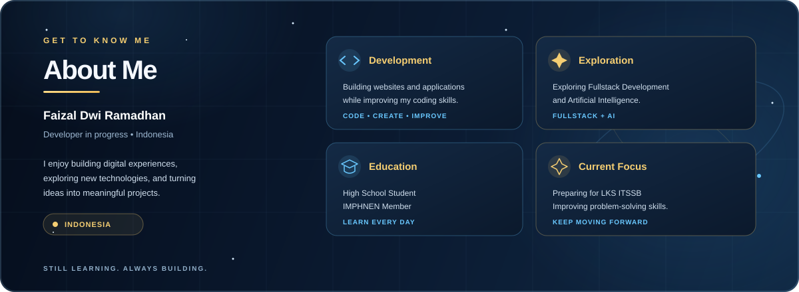
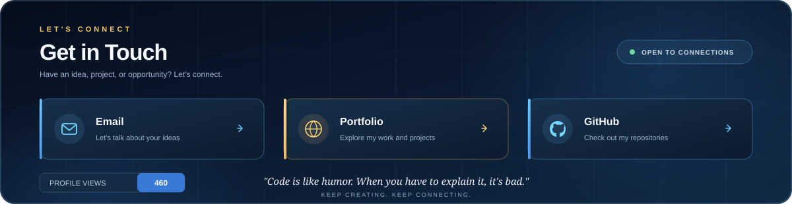

<!--

-->

  

---

  

<!--

  

-->

---

  

<!--

**Frontend** &nbsp; `XML` `JetpackCompose` `ReactNative` 

**Backend** &nbsp; `SpringBoot` `.NET` `Python` `FastAPI`

**Database** &nbsp; `MYSQL` `PostgreSQL` `API/RES`

**Tools** &nbsp; `Git` `VS Code` `Docker` `Figma` `VScommunity`

-->
---

  
  
  

 My Statistics

<table>
<tr>
<td width="57%" valign="top">

  

</td>
<td width="43%" valign="top">

</td>
</tr>
</table>

 

<!-- CONTACT DESIGN -->

  

<!-- ACTUAL CLICKABLE LINKS -->

  
  &nbsp;
  
  &nbsp;
  

  <picture>
    <source
      media="(prefers-color-scheme: dark)"
      srcset="https://raw.githubusercontent.com/falaizadev/falaizadev/output/pacman-contribution-graph-dark.svg"
    />
    <source
      media="(prefers-color-scheme: light)"
      srcset="https://raw.githubusercontent.com/falaizadev/falaizadev/output/pacman-contribution-graph.svg"
    />
    
  </picture>

